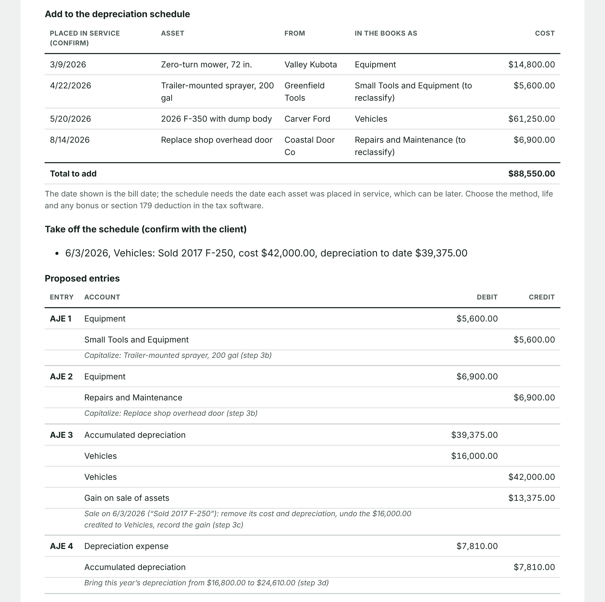
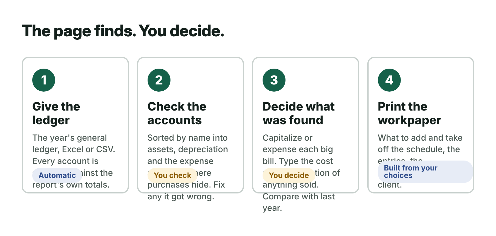
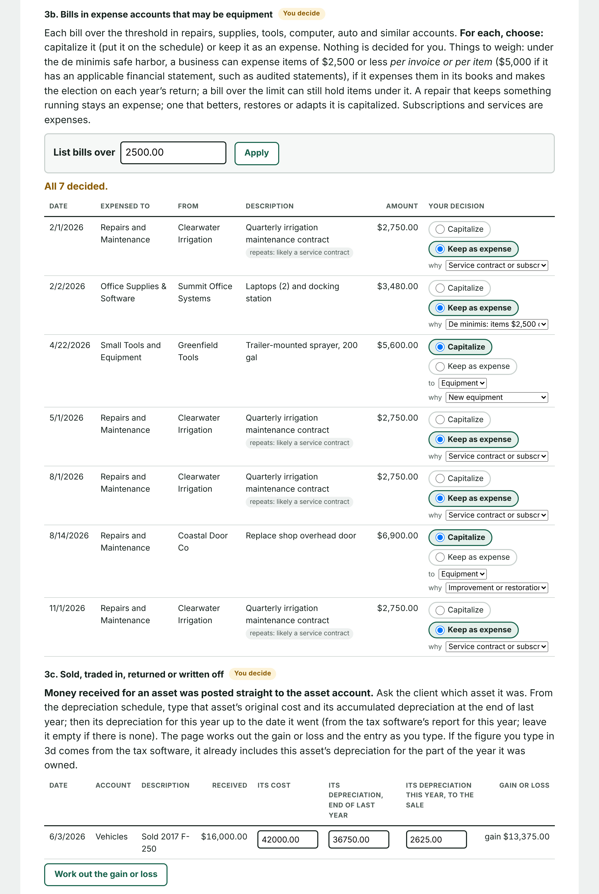

<!--
DRAFT FOR APPROVAL. Not published.
One Painful Problem, Series 1, Agent 5 (Acquire-to-Retire). For a LinkedIn article, published as a
newsletter edition. LinkedIn's editor has no tables: lists are used instead. Images are in images/.
SEO title (max 60): Year-end fixed asset review from the general ledger
SEO description (140-160): Find what belongs on a client's depreciation schedule from the general ledger, with a free tool you can rebuild yourself from one prompt. Sample data included.
-->

# Series 1 · Agent 5 | The year-end fixed asset review, done from the general ledger



In January, the bookkeeper at Ridgeline Landscaping sends over the year's books with a note: "We bought a new truck and a mower this year. Everything else is the same."

Last year's depreciation schedule has six assets on it. The new truck and the mower are in the Vehicles and Equipment accounts, where they belong. The rest of what the schedule needs is scattered through a hundred lines of general ledger:
- a $6,900 shop door replaced, posted to Repairs and Maintenance;
- a $5,600 trailer sprayer, posted to Small Tools;
- $16,000 from selling the old F-250, deposited and credited straight to Vehicles, so no gain was ever recorded and the truck's depreciation is still on the books;
- $16,800 of depreciation booked during the year, when this year's depreciation comes to $24,610.

Ridgeline is invented. It is the sample client for this tool. But every accountant who prepares year-end returns has met it. The depreciation schedule only knows what someone entered, and nobody tells you about the door.

Finding all of this by hand means reading every line of the fixed asset accounts, then filtering repairs, supplies and tools for big bills, then tying the opening balances to last year's schedule. For one client that is about an hour. Miss something and you skip a year of depreciation, expense a purchase that should be on the schedule, leave a gain off the return, or end up with books that no longer agree with it.

This is Series 1, Agent 5: a free tool that does the reading, so you can spend the time on the decisions.

## What it gives you

You drop in the client's general ledger for the year, exported from QuickBooks Online, QuickBooks Desktop or Xero. You get a workpaper you can print or save as a PDF:
- **What to add to the depreciation schedule,** with dates to confirm. For Ridgeline: the mower, the F-350, the door and the sprayer, $88,550.
- **What to take off.** The F-250, with the gain worked out: $13,375.
- **The proposed entries,** as numbered adjusting entries with debits and credits: reclassify the door and the sprayer, record the truck sale, bring depreciation up by $7,810.
- **The balances after those entries,** to tie to the schedule's totals.
- **The questions for the client.** When was each asset put into use? Is it new or used? For a vehicle: its gross vehicle weight rating, and the business-use percentage.
- **The roll-forward of cost and accumulated depreciation,** tied to the books.

The file is read on your computer. Nothing is uploaded, stored or sent.

## How it works: the page finds, you decide



The screen takes you through four steps. A bar at the top shows where you are, and each step says whether the page did it or you have to.

**1. Give the ledger.** Automatic. The page reads every account and checks that each one adds up to the report's own totals. If a line is missing, it stops and tells you to export the ledger again.

**2. Check the accounts.** You check. The page sorts the accounts by name: fixed assets, accumulated depreciation, depreciation expense, the expense accounts where purchases hide, and the rest. It recognizes QuickBooks' "Original cost" and "Depreciation" sub-accounts. It knows that "Truck Loan" and "Gain on Sale of Equipment" are not assets. If an account is wrong, you pick the right kind and everything is worked out again.

**3. Decide what was found.** You decide. This is where the hour goes, and where the tool helps most:
- **Purchases recorded as assets.** Listed automatically, with flags when one needs a second look: a trade-in recorded at the net price, land (not depreciated), a journal entry, or loan payments posted to the asset account.
- **Bills in expense accounts that may be equipment.** Every bill over $2,500 in repairs, supplies, tools, computer and auto accounts. **The page decides none of them.** You choose capitalize or keep as expense. The screen reminds you that the de minimis safe harbor is per invoice or per item, so Ridgeline's two laptops and a dock, $3,480 on one bill, can stay expensed. A quarterly service contract is marked as one.
- **Credits to asset accounts.** Sorted into returns, sales already booked properly, and money received for an asset that was posted straight to the asset. For those, you type the asset's cost and depreciation from the schedules, and the page works out the gain or loss and the entry.
- **Does it agree?** Type last year's schedule totals and this year's depreciation. The page compares them with the books.



**4. Print the workpaper.** Built from your choices. Anything still undecided is listed at the top in red, and left out until you decide it.

Before release, a separate AI review played a skeptical CPA. It found nine ways the first version gave wrong answers. It counted loan payments as purchases. It proposed reclassing a forklift that had already been reclassed. It treated a properly booked sale as unrecorded. It pre-ticked purchases as capital. All are fixed, and each is now one of the 22 test files the tool must pass, 758 checks in all. Two more reviews played a first-time user, working from the screen alone. After the first, the tool was rebuilt around its four steps. After the second, it got a workpaper you can file: journal entries, the balances after them, and a reason for each decision.

## Build it yourself

You don't need to download anything from me to have this tool. It comes from one prompt, and you can rebuild it with an AI assistant in about 15 minutes. You need no coding and no Excel skills.

**What you need**
- A computer with a web browser and an internet connection. The page you build loads its spreadsheet reader from the internet each time it opens. (The ready-made tool in the repository works offline.)
- An AI chat assistant that can write a long piece of code in one reply, such as Claude at claude.ai. The reply is long (about 1,000 lines), so a free plan may stop partway; a paid plan is safer.
- About 15 minutes, most of it waiting for the reply.

**Steps**
1. **Copy the prompt.** The safest copy is the master on GitHub. The repository's name is a single hyphen, so the address ends in "/-", and that is right. Open [PROMPT.txt](https://github.com/accountingnonerd/-/blob/main/acquire-to-retire/01-what-goes-on-the-asset-schedule/PROMPT.txt) and press the "Copy raw file" button (two small squares, top right of the file). It is also printed in full below.
2. **Paste it into a new chat** in your AI assistant and send it.
3. **Wait for one long block of code.** If the assistant offers it as a file to download, or shows it in a side panel with a download or copy button, use that. If the reply stops partway, write: "Please send the complete file again in one code block."
4. **Save it as a web page.** If there was no download, copy the whole code block into a plain-text editor and save it as what-goes-on-the-asset-schedule.html. On Windows, use Notepad: in the Save dialog, set "Save as type" to "All files", or it saves as .html.txt. On a Mac, use TextEdit: first choose Format, then Make Plain Text, and when it asks, choose "Use .html".
5. **Open it.** Double-click the file. You should see "What goes on the asset schedule?" and a box to drop a file into.
6. **Try it on the sample client** before any real file. Download the [Ridgeline Landscaping ledger](https://github.com/accountingnonerd/-/blob/main/acquire-to-retire/01-what-goes-on-the-asset-schedule/sample/ridgeline-general-ledger-2026.xlsx), [last year's schedule](https://github.com/accountingnonerd/-/blob/main/acquire-to-retire/01-what-goes-on-the-asset-schedule/sample/ridgeline-depreciation-schedule-2025.csv) and [this year's depreciation report](https://github.com/accountingnonerd/-/blob/main/acquire-to-retire/01-what-goes-on-the-asset-schedule/sample/ridgeline-depreciation-2026-from-tax-software.csv). On each page, press "Download raw file". Drop the ledger in and follow the steps on the screen.

**What you should see.** The top line reads "Ridgeline Landscaping LLC: $76,050.00 recorded as assets this year; $26,980.00 more found in expense accounts for you to decide; 1 sale or write-off to settle." In step 2, press "The accounts are right". In step 3b, capitalize the door and the sprayer (to Equipment, the default; the reason is optional) and keep the rest as expenses. For the old truck in 3c, type its $42,000.00 cost and $36,750.00 of depreciation at the end of last year, from last year's schedule, and $2,625.00 for this year, from this year's report. In step 3d, type the Total rows of the two schedules, 210,900.00 and 97,350.00, and this year's total, 24,610.00, then press Compare. The top line then reads "Ridgeline Landscaping LLC: $88,550.00 to add to the depreciation schedule; 1 asset to take off." The workpaper shows a gain of $13,375.00 and four adjusting entries, the last one $7,810.00 of depreciation. The full walkthrough is in the [sample's README](https://github.com/accountingnonerd/-/blob/main/acquire-to-retire/01-what-goes-on-the-asset-schedule/sample/README.md).

**If it does not work**
- *A blank page, or half a page:* the code was cut off. Ask the assistant for the complete file again.
- *Nothing happens when you drop the file:* the page could not load its spreadsheet reader. Check your internet connection; a company firewall can block it. Or use the ready-made tool.
- *A box forgets what you typed when you move to the next one:* tell the assistant exactly that, and ask it to keep what you type in every box and to work the figures out only when you press the button.
- *Different numbers:* tell the assistant what you expected, quoting the line above, and ask it to fix the file so it follows the prompt exactly.
- *Still stuck:* the ready-made, tested tool is in the repository. It is one file that works offline.

**The repository.** [The One Painful Problem repository on GitHub](https://github.com/accountingnonerd/-/tree/main/acquire-to-retire/01-what-goes-on-the-asset-schedule) holds everything for this tool:
- a README with these same steps;
- the master prompt;
- the sample client and what you should see;
- the ready-made tool;
- the 22 test files and their results.

Use it as the master copy if anything below looks wrong.

**The prompt.** Copy it from the master copy on GitHub if you can. LinkedIn can change quotes and line breaks.

```text
{{PROMPT}}
```

## What it doesn't do

- **It does not depreciate anything.** The method, life, bonus and section 179 stay in your tax software.
- **It does not see inside a bill.** A bill over $2,500 can hold items under the de minimis limit, so check the invoice before you capitalize.
- **It does not know what the client did with an asset.** A credit to an asset account could be a sale, a trade-in, an insurance payout or a correction. The questions for the client ask.
- **It does not handle everything on the balance sheet.** Leases, construction in progress and intangibles are out of scope. So is splitting a building's price between land and building.
- **It has not met real client exports yet.** It was tested on files built from QuickBooks' and Xero's published report layouts. If your export doesn't read, tell me and I will add the layout.

---

## What's next

This is the last agent of Series 1: one painful problem from each of the five accounting processes, each one free. Series 2 starts with the bank reconciliation.

**Subscribe to the One Painful Problem newsletter** so the next one reaches you, and so do the prompt, the sample and the tests.

**Rebuilt it?** Tell me in the comments what your AI assistant got right the first time, and what you had to ask it twice. Every comment makes the next prompt better.
