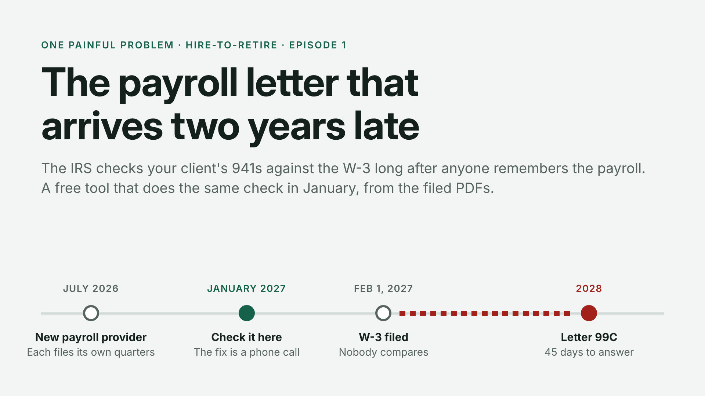
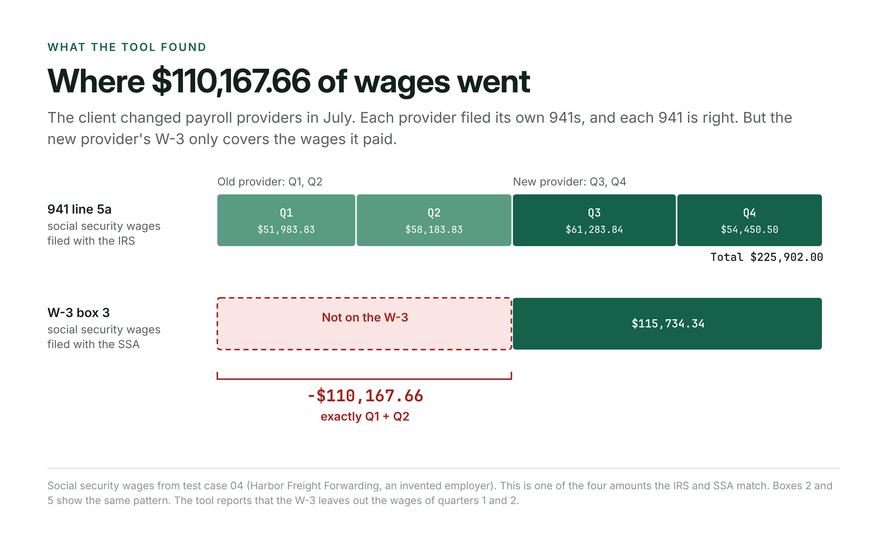
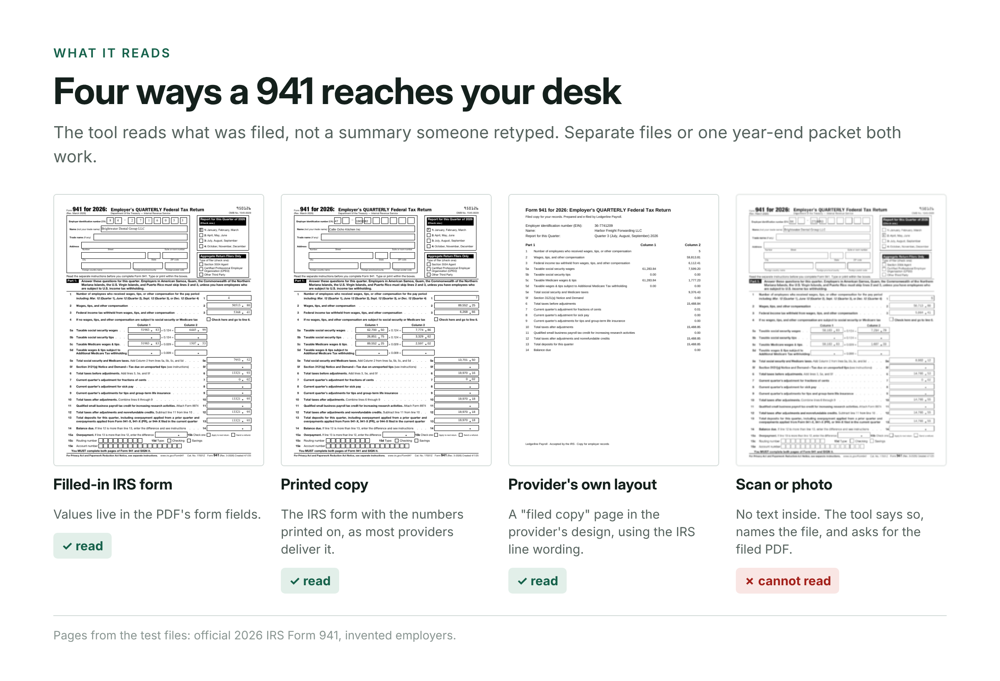
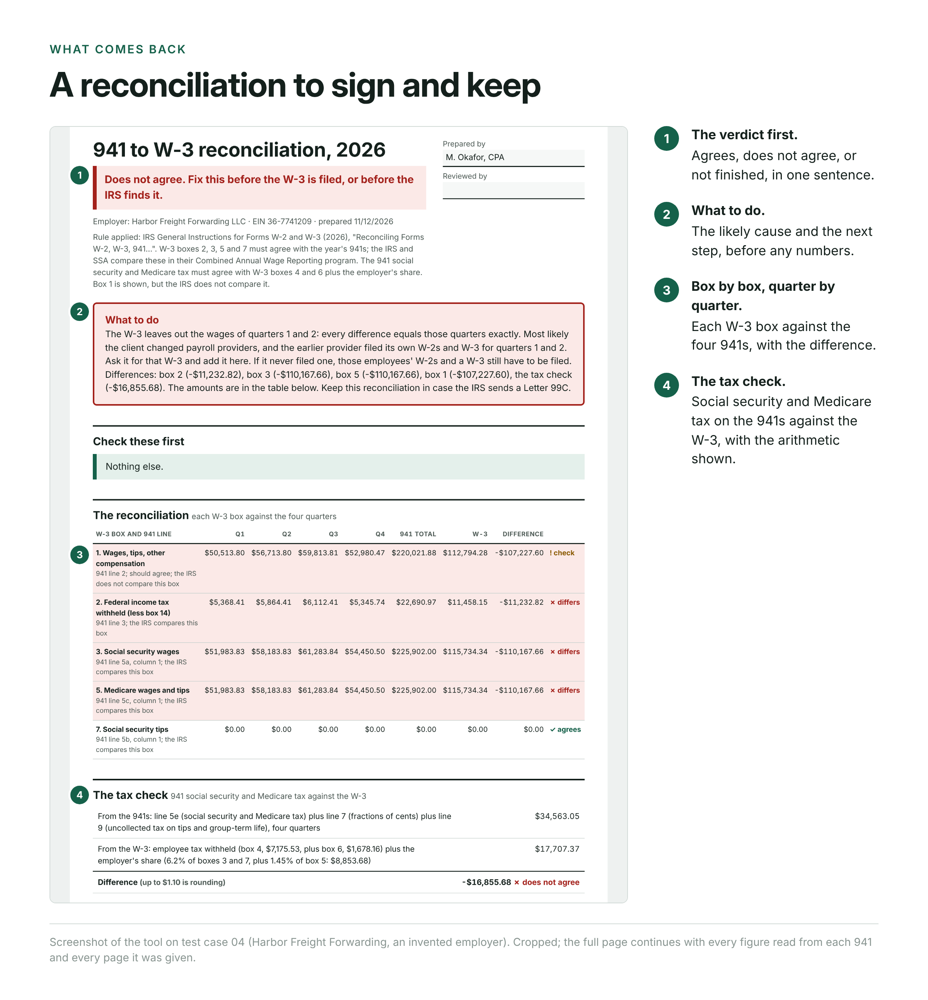
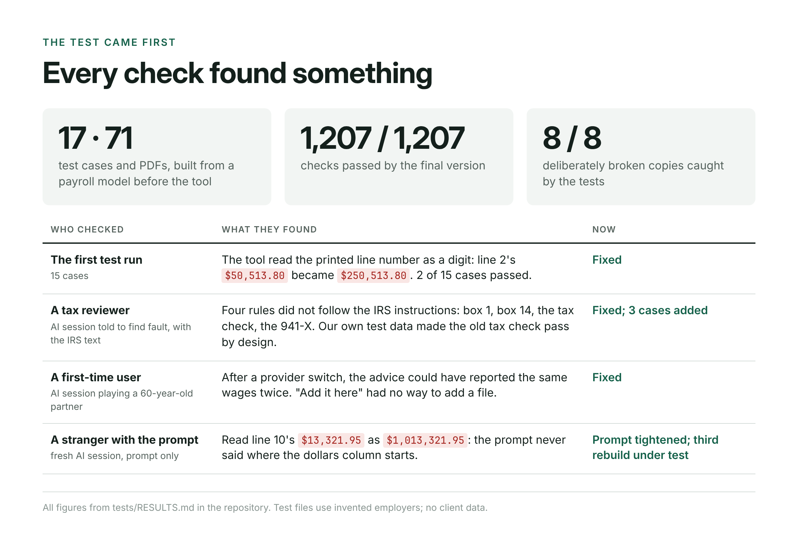
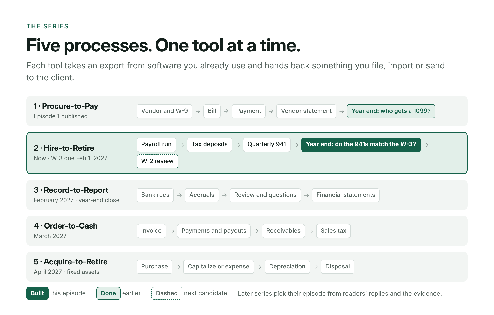

<!--
DRAFT FOR APPROVAL. Not published.
Series: One Painful Problem. Process: Hire-to-Retire. Episode 1.
Cover image: images/cover.png (1920 x 1080). Inline images: images/fig1 to fig5, each placed where it appears below.
-->

# The payroll letter that arrives two years late

This year the IRS has been matching 2024's payroll forms. It sets each employer's four quarterly Forms 941 against the W-3 that summarizes its W-2s. Where they disagree, it sends a Letter 99C with 45 days to answer ([IRS](https://www.irs.gov/businesses/small-businesses-self-employed/combined-annual-wage-reporting-employment-tax-problem-inquiries)).

Here is how one of those letters starts. A client changes payroll providers in July. The old provider files the 941s for January through June; the new one files July through December. In January the new provider files the W-3, which covers only the wages it paid. Every form is correct on its own. Nobody puts them side by side, and the gap waits two years for the IRS to find it.

That client is invented. It is one of our test files. The rule is not: the IRS General Instructions for Forms W-2 and W-3 tell employers to reconcile the W-3 with "the 2026 yearly totals from the quarterly Forms 941" and to "retain your reconciliation information in case you receive inquiries from the IRS or the SSA" ([IRS](https://www.irs.gov/instructions/iw2w3)). This is the second episode of a series that builds one small tool per step of an accounting process. This one is for payroll year-end, and the W-3 for 2026 wages is due February 1, 2027.

## Where $110,167.66 went

In the test file, the four 941s report $225,902.00 of social security wages. The W-3 reports $115,734.34. The difference, $110,167.66, is exactly the first two quarters. The same is true of federal withholding and Medicare wages. The likeliest explanation is not an error in anyone's software. The old provider filed its own W-3 for the first half, and nobody looked for it.

The tool says so in plain words: "The W-3 leaves out the wages of quarters 1 and 2." It tells the accountant to ask the earlier provider for its W-3 and add it. Given both W-3s, it adds them together and the year agrees.

## What it reads

The provider files the forms; proving they agree is left to the accountant. So the tool starts from what was filed. The accountant drops in the year's 941s and the W-3 as PDFs, as separate files or as one year-end packet.

It reads the official IRS form by the position of each line, and a provider's own layout by its line labels. Then it does what the IRS instructions describe: W-3 boxes 2, 3, 5 and 7 against the year's 941s, and the social security and Medicare tax against the W-3. Every figure shows the file and page it came from. It runs in the browser, uploads nothing, and the arithmetic is ordinary code. The same files always give the same answer.

## Every check found something

We wrote the test before the tool: 17 cases, 71 PDFs built from a payroll model. Some quarters are missing; some are a scan, last year's, or filed twice. One has an amended 941-X and one a quarter under an old EIN. One has third-party sick pay, and one a restaurant's uncollected tip tax. The final version passes all 1,207 checks. We then broke it on purpose eight ways, and the tests caught every one.

Getting there was humbling.

The first test run passed 2 of 15 cases. The IRS prints each line number just left of its amount, and the tool read the "2" as part of the number: $50,513.80 became $250,513.80.

A separate AI session, told to act as a skeptical payroll-tax reviewer, found four places where our rules did not follow the IRS text:
- the IRS does not compare box 1;
- box 2 must be reduced by third-party sick pay withholding in box 14;
- the tax check needed the employer's share worked out properly;
- an amended 941-X for the same year belongs in the totals, not set aside.

It also found that our test data had been built so the old tax check would always pass.

Another session, playing a 60-year-old partner with no patience for software, found the most dangerous line. After a provider switch, the tool advised filing corrected W-2s, which could have reported the same wages twice. It now asks for the other W-3 first.

REBUILD_STORY_PLACEHOLDER

By hand, our estimate is about 20 minutes per client when nothing is wrong: copy 40 figures from four 941s and 7 from the W-3, add, compare. That is an estimate, not a measurement; the next round times a practicing accountant.

## What it won't do

It compares the forms it is given with each other, not with the IRS's records. It does not check individual W-2s, state forms, Form 940 or deposits. It cannot read a scan; a person can. It is not for aggregate filers or PEOs, successor-employer arrangements, household employers, or 943, 944 and CT-1 filers. Some differences are valid, and when it flags one the reason is the accountant's to confirm.

## The series

Episode 1 found the 1099 vendors your software misses. This is episode 2. Every tool comes with its test files, its results, and one prompt that rebuilds it from nothing. The prompt is below, and everything else is at [github.com/accountingnonerd/-](https://github.com/accountingnonerd/-).

## Your turn

What part of payroll year-end do you still do by hand? Tell me the step, the form it starts from, and how long it takes.

---

## Appendix: the rebuild prompt, in full

PROMPT_PLACEHOLDER
