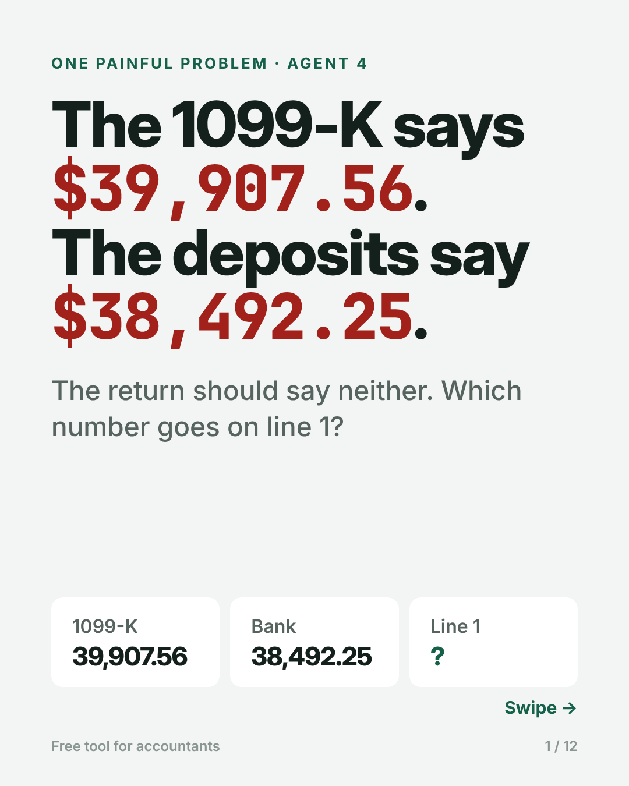
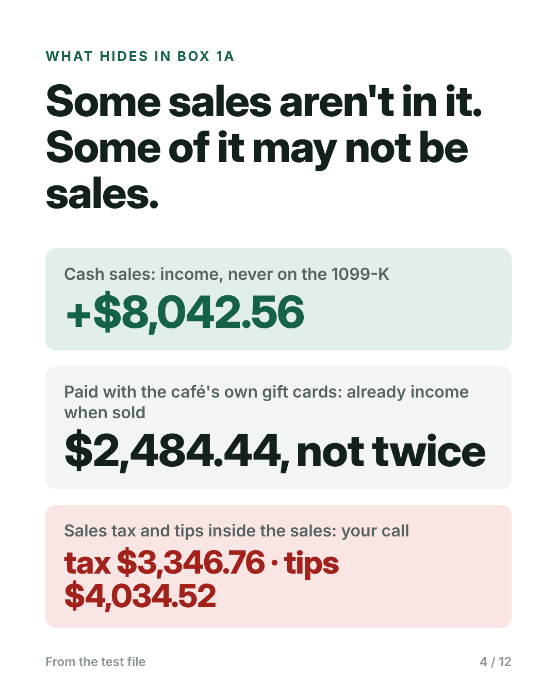
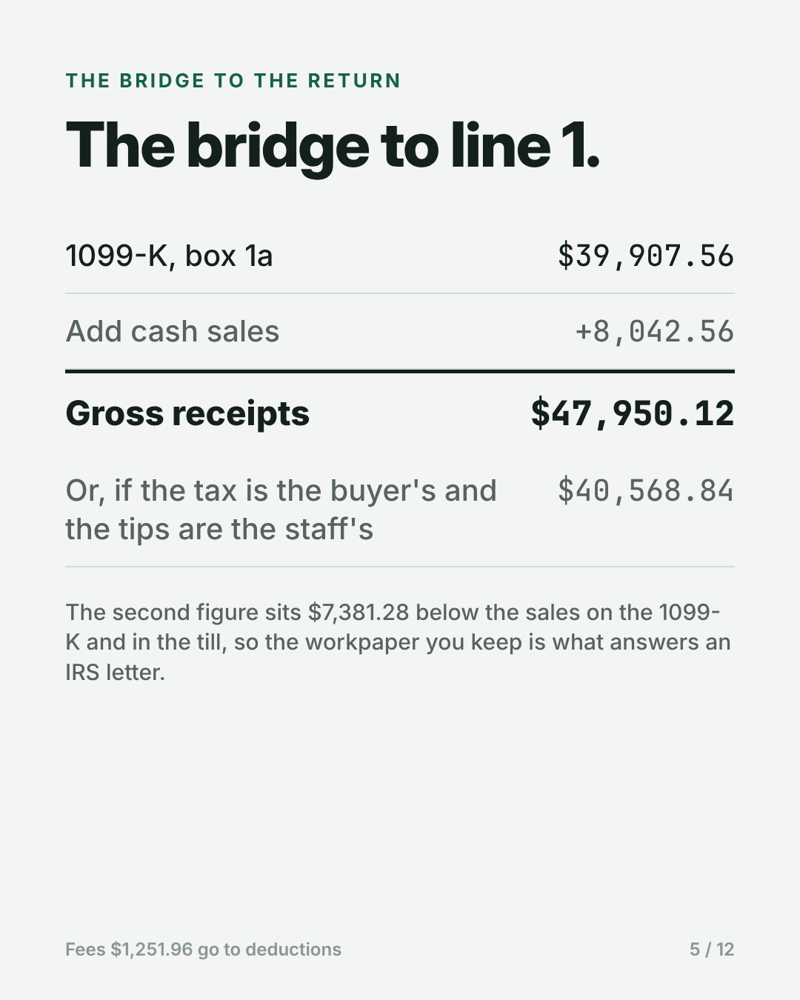
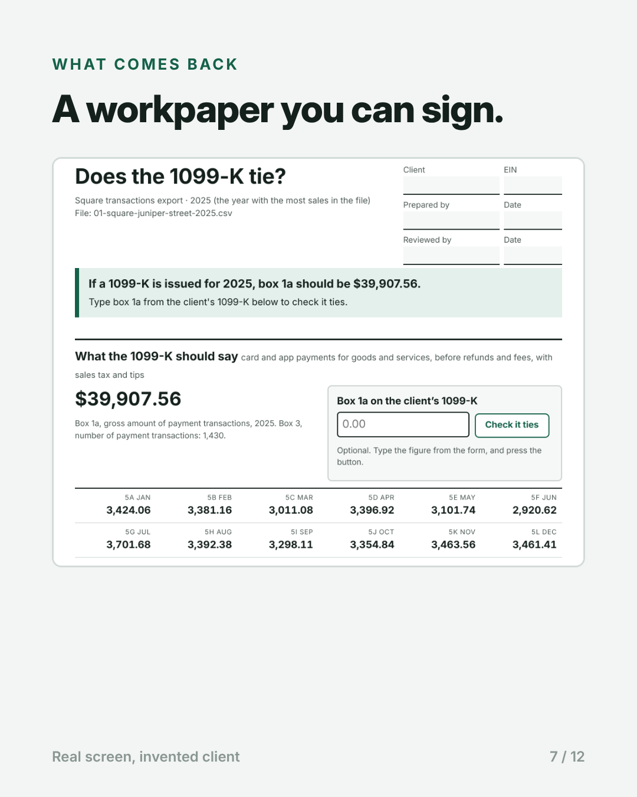
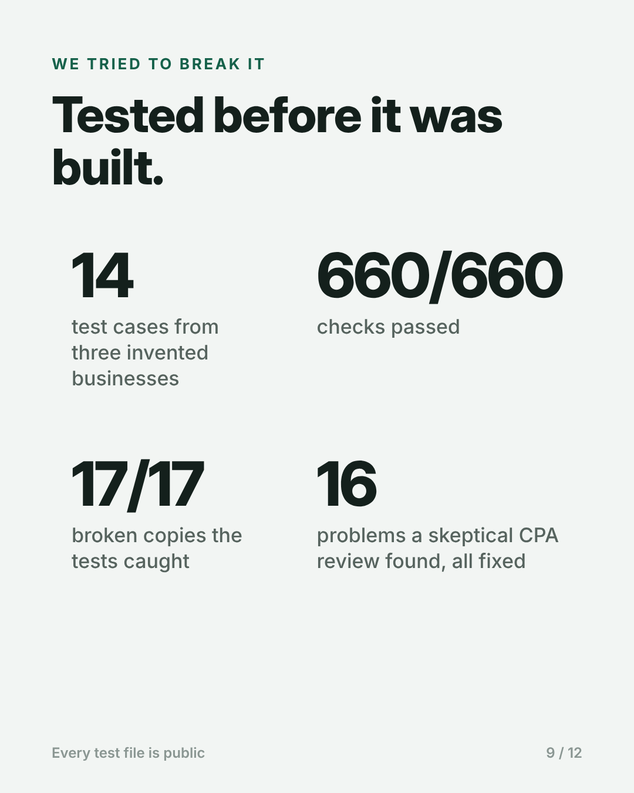

<!--
DRAFT FOR APPROVAL. Not published.
Series: One Painful Problem, Series 1, Agent 4 (Order-to-Cash).
For the LinkedIn newsletter edition and the repository. Images are slides from the carousel (carousel/slides/).
-->

# Series 1 · Agent 4: The 1099-K says one number. The bank says another.

A café owner drops off her tax papers in February. On top is a Form 1099-K from Square: $39,907.56. Her bookkeeper's books, built from the bank feed, show card sales of $38,492.25. Neither number is what goes on line 1 of her return.

That café, Juniper Street Coffee, is invented; it is one of our test files. The form is not. Every business that takes cards gets a 1099-K from its processor "no matter how many payments you got or how much they were for" ([IRS](https://www.irs.gov/businesses/understanding-your-form-1099-k)), and the 2026 forms arrive by January 31, 2027. This is Series 1, Agent 4: a free tool that turns a client's year of Square, Stripe or PayPal transactions into what the 1099-K should say, and ties it to the return and to the bank.

## Why the numbers never match

The 1099-K counts gross. The IRS instructions define box 1a as the total of card and app payments "without regard to any adjustments for credits, cash equivalents, discount amounts, fees, refunded amounts, shipping amounts, or any other amounts" ([IRS](https://www.irs.gov/instructions/i1099k)). The bank sees what is left after the processor takes its fees and holds back late-December sales until January.

So books built from deposits come in low. Intuit's own help page for preparers warns that "the client may receive an IRS notice if the gross receipts don't reflect amounts from the 1099-K" ([Intuit](https://accountants.intuit.com/support/en-us/help-article/form-1099-k/entering-form-1099-k-transactions-proconnect-tax/L1sbeU13g_US_en_US)). A preparer on the Intuit community put the everyday version plainly: "The 1099K shows more than what the deposits in the bank are... Do I gross up sales that were recorded as net deposits?" ([thread](https://accountants.intuit.com/community/proconnect-tax-discussions/discussion/1099-for-s-corp/00/229306)).

And the 1099-K is not gross receipts either:
- cash sales are income, but never on it;
- payments with the business's own gift cards are left off it, and should not be added back, because the gift card was income when it was sold;
- sales tax and tips are inside it. Whether they belong on line 1 depends on the state and on who keeps the tips. A preparer asking about "$176K in a 1099" with over $13,000 of sales tax inside it got two different answers in the same thread ([thread](https://accountants.intuit.com/community/proseries-tax-discussions/discussion/accounting-treatment-for-1099-k-that-includes-sales-tax/00/283709)).

## What the tool does

You drop in one export, the one the client can download in two minutes: Square's transactions CSV, Stripe's itemized balance activity, or PayPal's activity download. Type box 1a from the client's 1099-K if you have it. The page returns a workpaper with:
- what the 1099-K should say: box 1a, box 3, and each month, 5a to 5l;
- whether it ties, and if not, by how much and the likely cause;
- the bridge to the return: gross receipts, returns and allowances, merchant fees, with sales tax and tips included as the 1099-K includes them, and a box to leave them out where the law allows;
- the tie to the bank deposits, top to bottom;
- the year-end entry for books that recorded deposits as sales, with proof that sales afterwards equal the 1099-K gross;
- the questions for the client.

It runs in the browser and uploads nothing. The arithmetic is ordinary code, in whole cents.

## What it catches

In the test files: a 1099-K $2,184 higher than the export, because a second location reports on the same tax ID. Friends-and-family transfers through PayPal with no fee, which may be customers dodging the fee or may be personal. A December 31 sale that Stripe's UTC export dates January 1. Two exports pasted together, so June counts twice. A payment PayPal marks "Refunded" that still belongs in gross.

## We tried to break it

We wrote the test first: 14 cases from three invented businesses, a café on Square, an online shop on Stripe and a print seller on PayPal. The final version passes all 660 checks. We then broke it on purpose 17 ways; the tests caught every one.

The first run passed 8 of 14. Box 3, the count of payments, included cash-only sales, which never reach a 1099-K.

A separate AI session, told to review the tool as a skeptical CPA, found sixteen problems. The worst: gift cards were counted twice, once when sold and again when redeemed. Sales tax and tips were taken out of gross receipts by default, which is wrong in California and in states whose tax falls on the seller, and wrong for an owner who keeps the tips; that would also put line 1 below the 1099-K, the very mismatch the tool exists to prevent. Gross receipts now include them, and leaving them out is the accountant's tick, with the warning printed.

Another session, playing a 60-year-old partner who had never seen the tool, footed the bank bridge and found the bold total was not the sum of the lines above it. It now foots top to bottom.

REBUILD_PARAGRAPH

By hand, we estimate about 50 minutes for a clean client and over an hour and a half when something is wrong, before any call to the client. That is an estimate, not a measurement.

## What it won't do

It does not read the 1099-K itself; you type box 1a and check the payee's tax ID, box 4 and the state boxes, which the page lists. It reads Square, Stripe and PayPal, not Shopify, Venmo or the marketplaces. It does not decide sales tax or tips for you. Our layouts were built from the processors' published column names, not from a real client's export, and it does not see what Square takes from deposits outside the transactions export.

## The series

Agent 1 found the 1099 vendors your software misses. Agent 2 checked the 941s against the W-3. Agent 3 checked whether last year's books still match what you filed. This is agent 4; agent 5 covers fixed assets. Every agent comes with its test files, its results and one prompt that rebuilds it. The prompt is below; everything else is at [github.com/accountingnonerd/-](https://github.com/accountingnonerd/-).

## Your turn

Which tax-season reconciliation still eats your evenings? Tell me the task, the document it starts from, and how long it takes.

---

## Appendix: the rebuild prompt, in full

REBUILD_PROMPT
