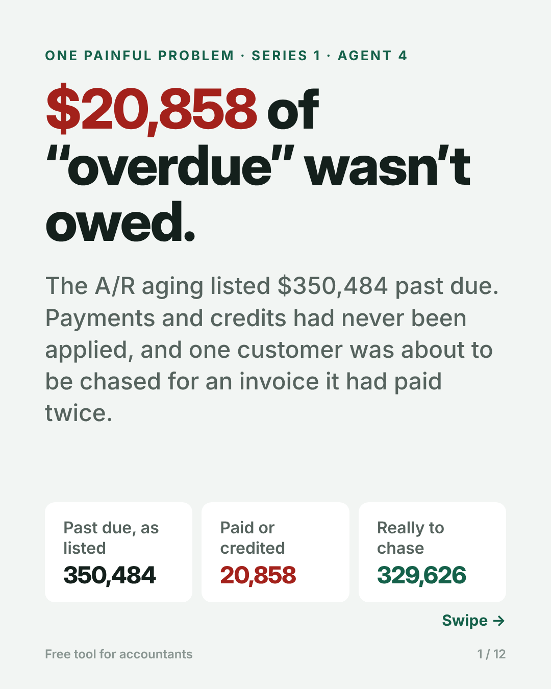
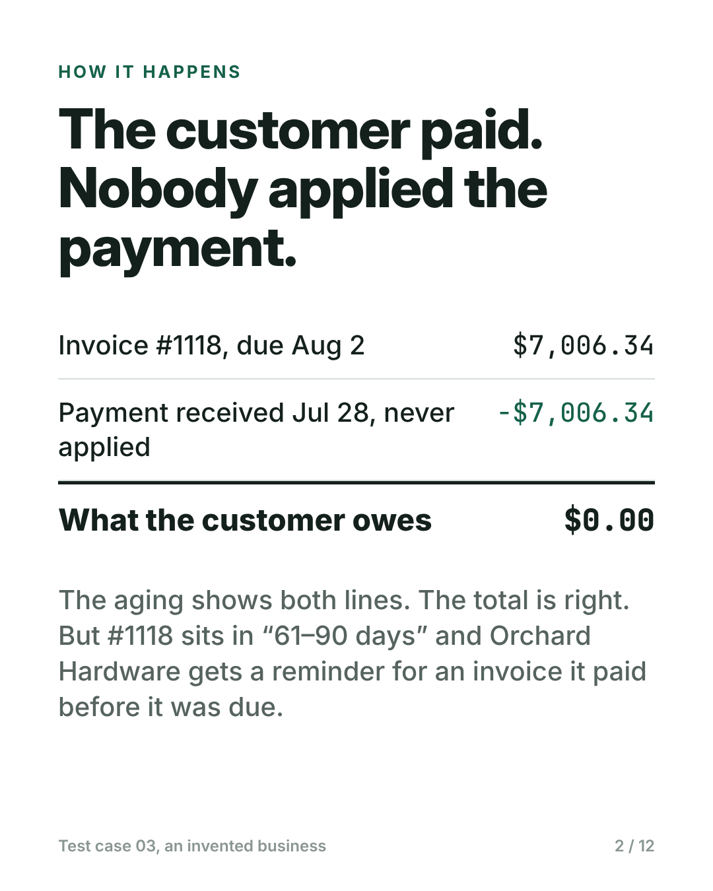
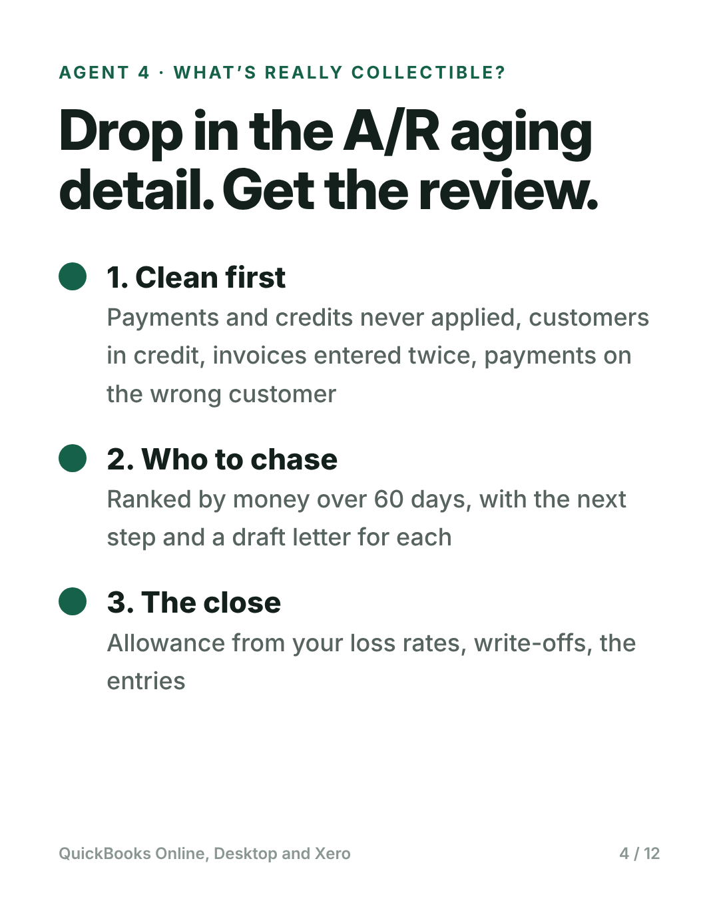
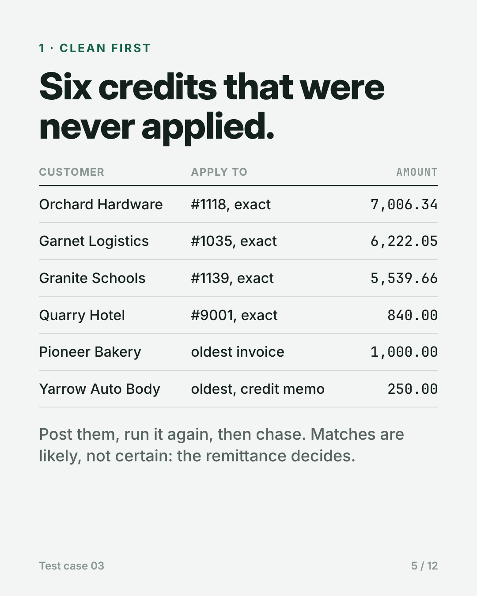
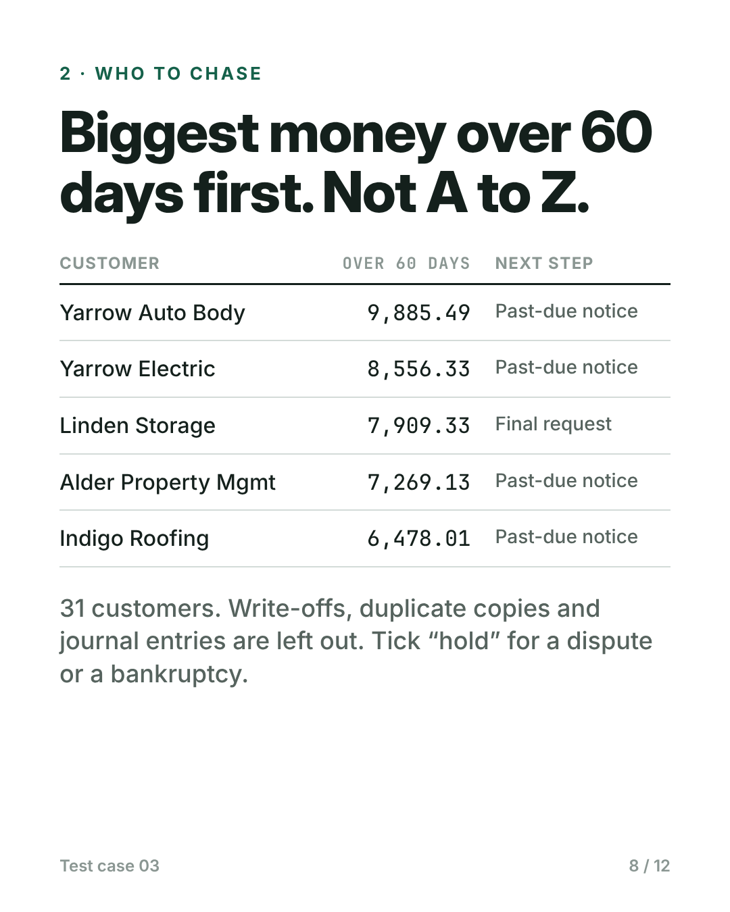
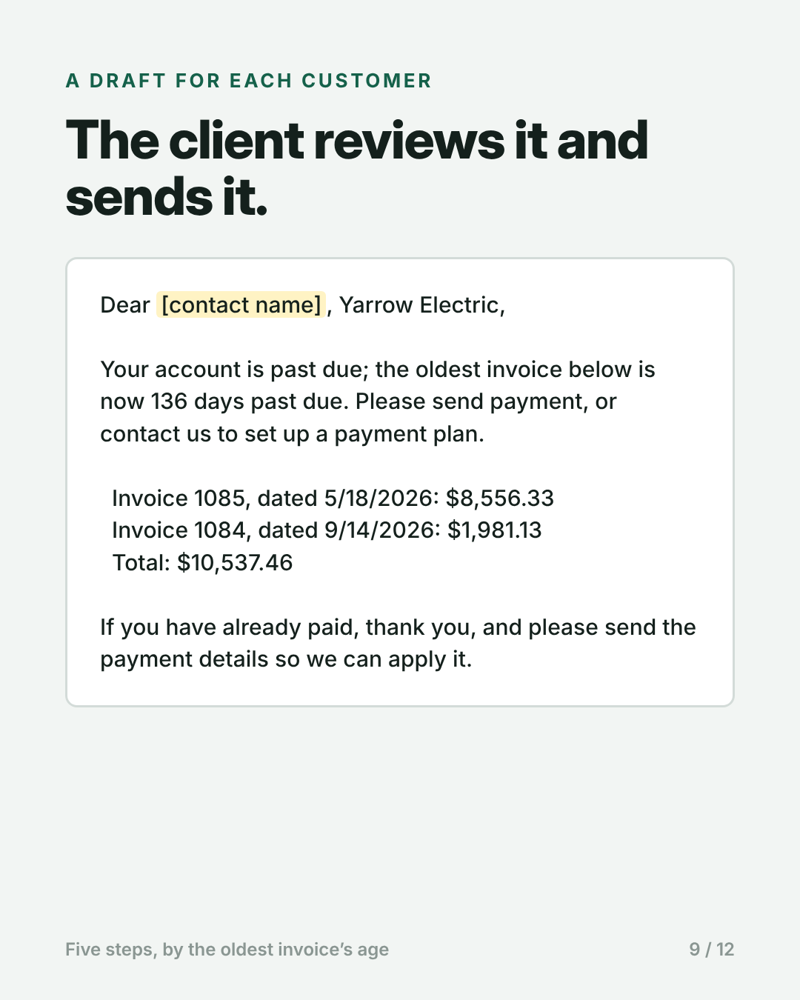
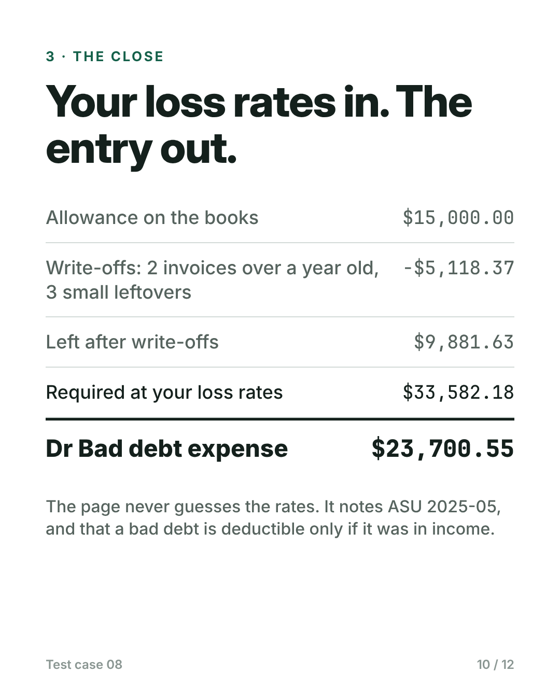
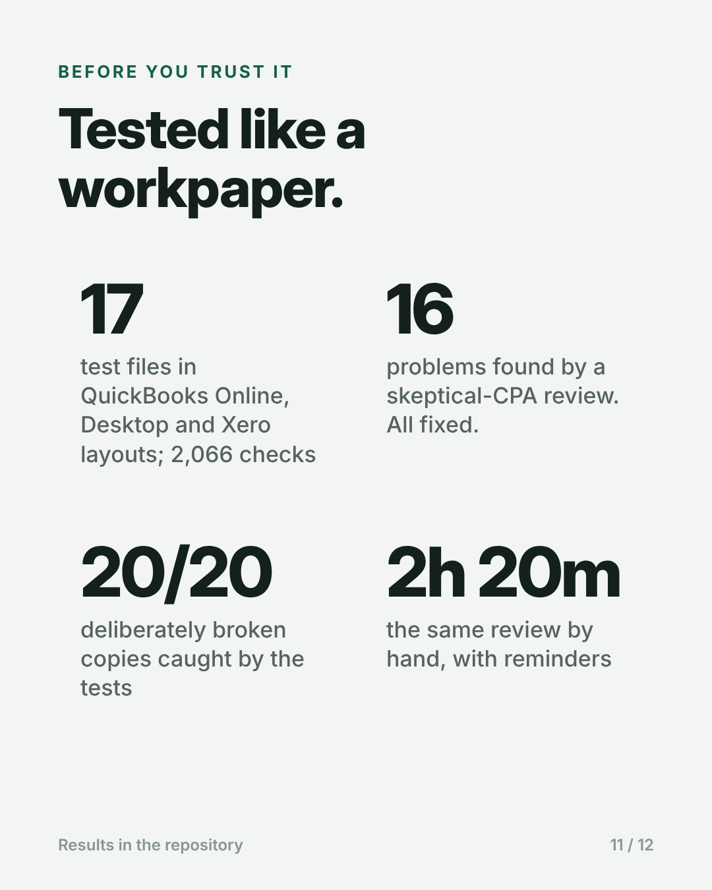

<!--
Post published on LinkedIn 2026-11-16 via Typefully. Newsletter edition: to be published by the account owner.
Series: One Painful Problem, Series 1, Agent 4 (Order-to-Cash).
For the LinkedIn newsletter edition and the repository. Images are slides from the carousel (carousel/slides/).
-->

# Series 1 · Agent 4: $20,858 of "overdue" wasn't owed

At the end of October, Granite Facility Services had 152 open items on its A/R aging. $350,484 of them were past due. The plan was the usual one: send reminders to every customer with a past-due balance, starting with the oldest.

Thirty-two letters would have gone out. Four of them would have asked customers to pay invoices they had already paid. One of those customers, Quarry Hotel, had paid the same $840 invoice twice. It was owed money, and it was about to get a past-due notice.

Granite is invented; it is one of our test files. The pattern is not. Every client that invoices has an aging, and most of them have late payers. Intuit's 2025 late payments report found 56% of US small businesses waiting on unpaid invoices, about $17,500 each on average, and 47% with invoices more than 30 days overdue (as reported in press summaries). So this is Series 1, Agent 4: a free tool that turns a client's A/R aging into the review the accountant is supposed to do at every close.

## Why the aging lies without being wrong

Orchard Hardware paid invoice #1118, $7,006.34, on July 28, five days before it was due. The bookkeeper recorded the payment but never applied it to the invoice. So the aging shows both lines: the payment as a credit, and #1118 as 90 days past due.

The total is right. The aging is not. CPA Practice Advisor describes the same thing in QuickBooks: an unapplied payment leaves the net balance correct, but both the credit and the invoice are "still listed" as open ([CPA Practice Advisor](https://www.cpapracticeadvisor.com/2019/02/26/quickbooks-data-file-analysis-with-the-client-data-review-tool/764/)). Anyone who chases from that list chases paid invoices.

That is why year-end checklists tell accountants to "identify any unapplied credits or overpayments" and "review aging reports, focusing on accounts that have remained outstanding for over 90 days" ([CPA Practice Advisor](https://www.cpapracticeadvisor.com/2024/11/07/end-of-year-accounts-receivable-checklist-ensuring-financial-stability-for-your-clients-into-the-new-year/152124/)). The ledger's aging lists the open items. It does not do the review. Reminder apps chase invoices; they do not clean the ledger, and they do not write the workpaper.

## What the tool does

You drop in the A/R aging detail, exported to Excel or CSV from QuickBooks Online, QuickBooks Desktop or Xero. If you have it, you type A/R from the balance sheet. You get back a workpaper in three parts.

**1. Clean first.** The page goes customer by customer, and job by job. Each payment or credit memo that was never applied is matched to an open invoice of exactly the same amount, the oldest one first. Whatever is left is applied to the oldest invoices. For Granite, that is six credits: four exact matches, a $1,000 payment and a $250 credit memo.

What is still left after that is money the client owes the customer. The page says why it is likely there:
- **Paid twice.** Quarry Hotel's second $840 payment. Refund it, or confirm with the customer that the credit should stay.
- **Posted to the wrong customer.** In another test file, Keystone Apartments has a $1,250 credit that matches Indigo Storage's open invoice #9150 to the cent. Move it, and Indigo stops getting reminders.
- **Another job of the same customer.** A credit on one job when another job has open invoices.

At the close, credit balances are reclassified to a liability, not netted against receivables. They are never written off to income: old customer credits become unclaimed property.

It also stops you when the file cannot be trusted yet: an invoice entered twice ($9,632.43, two days apart, but not a $450 bill sent twice a week, which is recurring billing); an aging that does not tie to the balance sheet; part of the report pasted in twice, which it removes only when the report's own total proves it; a journal entry sitting in A/R.

**2. Who to chase.** Customers are ranked by how much they owe more than 60 days past due, then by everything overdue, not alphabetically. Each one gets a next step based on its oldest invoice: a friendly reminder, a second request and a call, a call about the account, a past-due notice, or a final request. Write-offs, the second copy of a duplicate and journal entries are left out.

Each customer gets a draft letter listing its invoices, dates, amounts and days past due. The placeholders are in brackets because the client decides who it goes to and how to get paid. There is a "Hold letter" box for a customer in a dispute, on a payment plan, or in bankruptcy, where a letter can breach the automatic stay. If the aging does not agree with the balance sheet, every letter is held until it does.

**3. The close.** You type the client's expected loss rate for each age bucket. The page never guesses them; they are your judgment, from the client's history. It works out the allowance on what is left after the clean-up and the write-offs. If you type the allowance already on the books, it works out the entry too.

For Copperline Plumbing Supply, another test file, the books carry $15,000. Proposed write-offs use $5,118.37 of it: two invoices more than a year past due, and three part-paid invoices with a few dollars left. The rates call for $33,582.18, so the entry is Dr Bad debt expense, Cr Allowance, $23,700.55. The write-offs are booked as credit memos dated in the open period, not as journal entries to A/R.

Two notes go with it. ASU 2025-05 applies to years beginning after December 15, 2025. Any entity may assume that conditions at year end continue for current receivables, and a private company may also elect to consider cash collected after year end ([RSM](https://www.rsmus.com/insights/financial-reporting/amended-guidance-for-measuring-credit-losses-on-short-term-receivables)). For tax, a business bad debt is deductible only if the amount was included in income ([IRS Topic 453](https://www.irs.gov/taxtopics/tc453)). The allowance itself is not deductible.

It runs in the browser and uploads nothing. The arithmetic is ordinary code, in whole cents.

## How it was tested

Before the tool existed, there were 17 test files: A/R aging detail reports in the layouts of QuickBooks Online, QuickBooks Desktop and Xero, for invented businesses. Three were clean, five had a problem planted in them, and nine were ugly: no as-of date, dollar signs and parentheses in a CSV, jobs under customers, the A/P aging dropped in by mistake, the summary instead of the detail. The answer key was worked out from a model of every open item, never by reading the files back. Today the tool passes all 17, 2,066 checks.

The first build passed every case at once. That proved little: the tool and the answer key followed the same rules, and we wrote both. The real test was a separate AI session told to act as a skeptical CPA who does monthly closes. It found 16 problems. The worst three:
- **A credit that paid off a customer exactly disappeared.** An $800 check for a $500 and a $300 invoice produced no clean-up at all.
- **Two real $500 payments on the same day were treated as a pasted copy.** One was deleted, and the customer would have been chased for money it had paid.
- **With no as-of date in the file, every invoice was "current".** The page said nobody was overdue.

All 16 are fixed, and each one is now a test case, so it cannot come back. Then 20 deliberately broken copies of the tool were run against the tests, each with one rule wrong. The tests caught all 20.

By hand, the same review of a typical client takes about 2 hours 20 minutes, 90 of them writing reminders. The tool takes seconds. The minute-by-minute estimate is in the repository.

## What it does not do

- It does not know the client's loss history. You type the rates.
- It does not know about disputes, payment plans, retainage or customer deposits. You decide those.
- Its matches are likely, not certain: the customer's remittance decides.
- It sends nothing. The letters are drafts for the client.
- It has been tested on files built from the products' published layouts, not yet on a real client's export. If yours does not read, tell me and I will add the layout.

## Get it

The tool is one HTML file. Open it in a browser and drop in the aging; there is a made-up sample on the page if you want to see it first. The repository has the tool, the 17 test files, the answer key, the results, a 25-minute script for testing it with an accountant, and the prompt that rebuilds it from nothing. The link is in the first comment under the post.

---

This is Series 1 of One Painful Problem: one agent for each accounting process, each solving a problem every practice has. Agent 5, in Acquire-to-Retire, is the fixed asset register: the depreciation roll-forward tied to the trial balance.

What do you check first on a client's aging?
