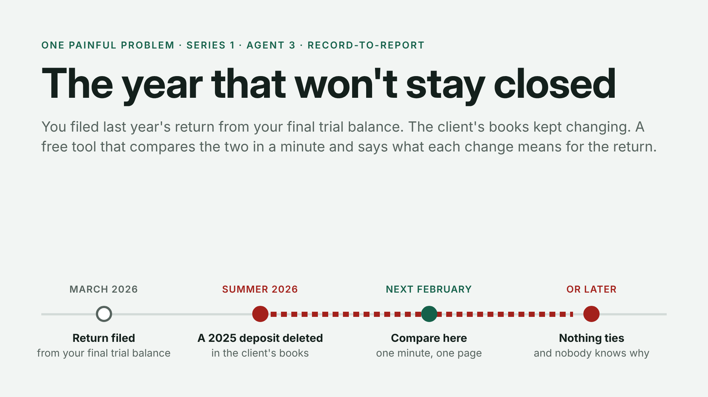
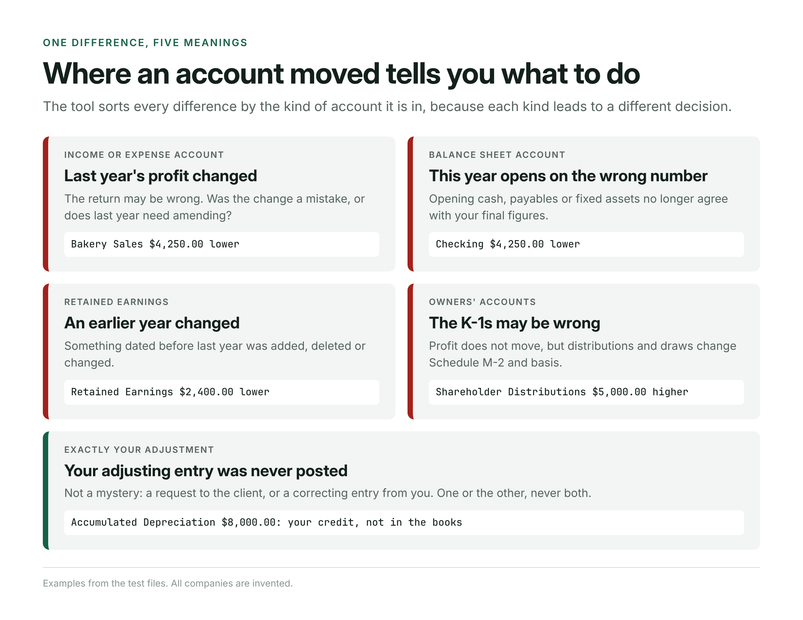
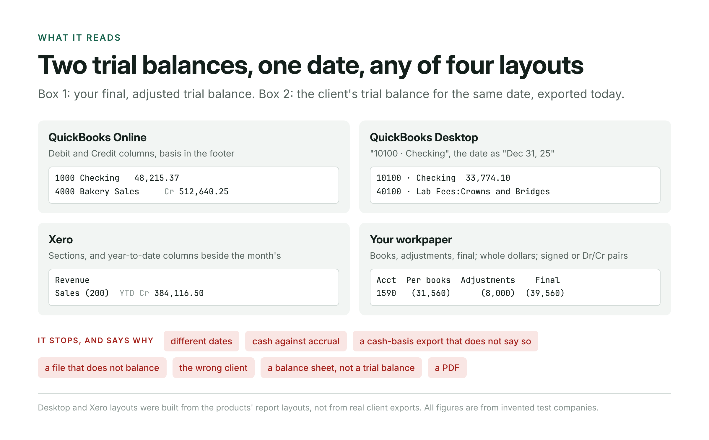
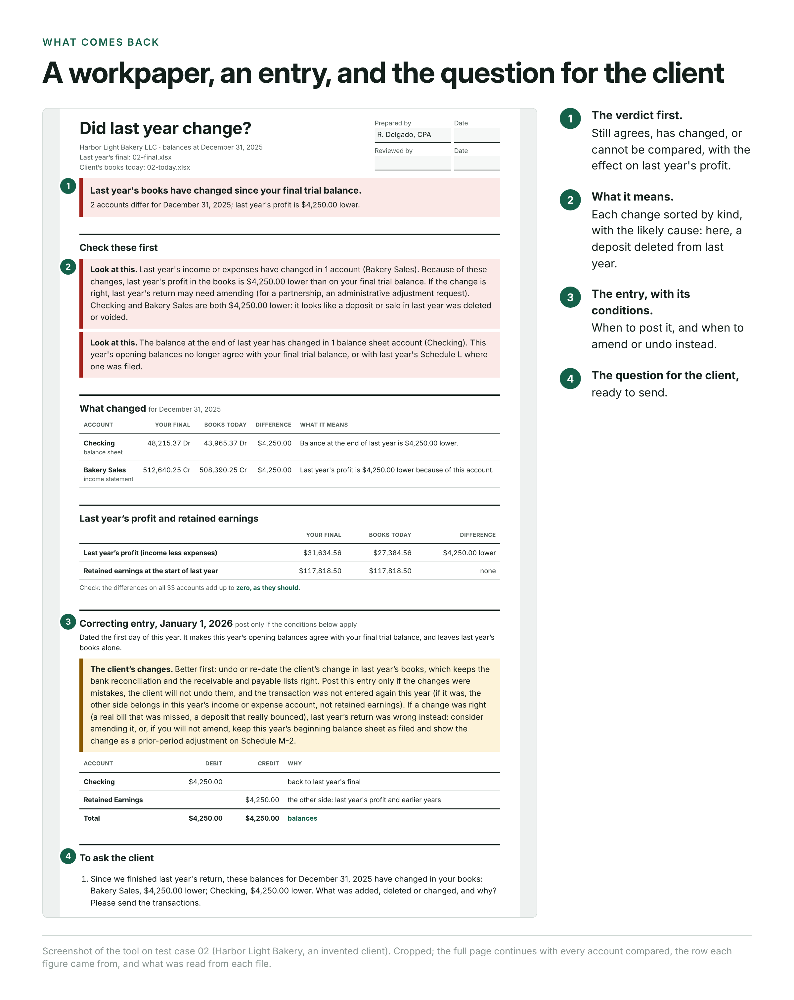
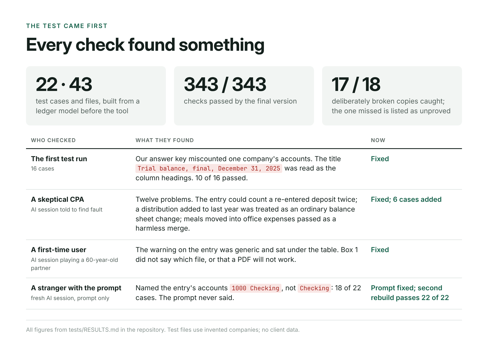
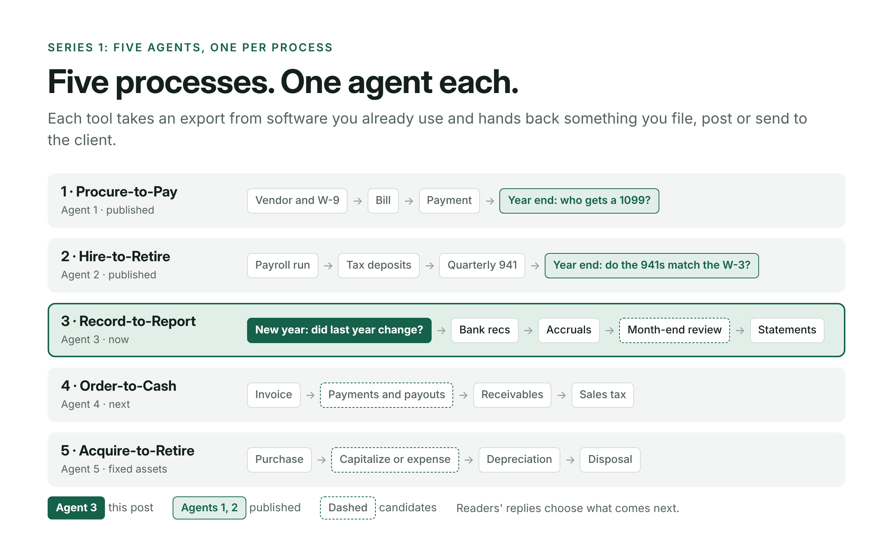

<!--
DRAFT FOR APPROVAL. Not published.
Series: One Painful Problem, Series 1, Agent 3 (Record-to-Report: the close).
Cover image: images/cover.png (1920 x 1080). Inline images: images/fig1 to fig5, each placed where it appears below.
-->

# Series 1 · Agent 3: The year that won't stay closed

You prepared a client's 2025 return from your final trial balance, and filed it in March. The client's books stayed open, because they are the client's books. Some time that summer, someone deleted a $4,250 December deposit from 2025.

Nothing announces it. Months later the new year's work starts from balances that no longer exist. Opening cash is $4,250 short of the Schedule L you filed, and last year's sales in the books no longer match the return. The question is no longer "what is the number" but "what happened, and when".

That client, Harbor Light Bakery, is invented; it is one of our test files. The rule is not: the IRS instructions for Form 1120-S say of Schedule L, "The balance sheets should agree with the corporation's books and records" ([IRS](https://www.irs.gov/instructions/i1120s)). This is Series 1, Agent 3. Each series builds five small agents, one for each process accountants run for clients, and each takes one painful step off the desk. This one is for the start of a new year in Record-to-Report: proving last year's books still say what you filed.

## What practitioners describe

A preparer on the Intuit Accountants Community, trying to finish a return: "The owner deleted several transactions. they are correct now, however the beginning balance is different" ([thread](https://accountants.intuit.com/community/practice-advice-17/quickbook-online-beg-balance-difference-5671)). Another, asked why a balance sheet would not tie: "Tie out ALL numbers the the trial balance, and you'll find the error" ([thread](https://accountants.intuit.com/community/proconnect-product-discussions-6/why-does-my-ending-balance-sheet-not-match-up-94933)).

That tie-out is the job. Line up two trial balances, account by account, and work out what each difference means. QuickBooks and Xero can list transactions changed after a closing date. They cannot compare the books with *your* final figures, which often include adjusting entries that live only in your workpapers.

## Where an account moved tells you what to do

The same $4,250 means different things depending on where it lands.
- **In an income or expense account,** last year's profit changed, and the question is whether to amend.
- **In a balance sheet account,** this year opens on the wrong number.
- **In retained earnings,** a year before last changed.
- **In a distribution or draw,** profit does not move but the K-1s and basis do.
- **If the difference is exactly one of your own adjusting entries,** it is not a mystery at all: the client never posted it.

The tool sorts every difference that way. On Harbor Light it says: "Checking and Bakery Sales are both $4,250.00 lower: it looks like a deposit or sale in last year was deleted or voided."

## What it reads, and what comes back

You drop in two files, both Excel or CSV:
- **Box 1:** last year's final trial balance;
- **Box 2:** a trial balance for the same date, exported from the client's books today.

It reads QuickBooks Online, QuickBooks Desktop and Xero exports, and a workpaper with books, adjustments and final columns in whole dollars. It runs in the browser, uploads nothing, and does its arithmetic in whole cents in code.

What comes back is a workpaper to sign:
- the verdict;
- every change and what it means;
- last year's profit, final against today;
- a correcting entry dated the first day of the new year, with the conditions for posting it;
- the question to send the client.

It refuses to compare two files for different dates, cash against accrual, the wrong client, or a balance sheet passed off as a trial balance, and says why.

## We tried to break it

We wrote the test first: 22 cases and 43 files across four invented companies. Seven have a planted change: a deleted deposit, a backdated bill, a 2024 purchase re-entered as an expense, a voided check, a damaged file, a distribution added after filing, and a year's meals moved into office expenses. The final version passes all 343 checks. We then broke it on purpose 18 ways. The tests caught 17. The one they missed, an export date printed above the column headings and read as the balance date, has no test file yet; it is listed as unproved.

The first run passed 10 of 16. Our own answer key had miscounted one company's accounts, and a workpaper title, "Trial balance, final, December 31, 2025", was read as the column headings.

A separate AI session, told to act as a skeptical CPA, found twelve problems. The worst: if the client deleted a deposit and entered it again in January, our correcting entry would have counted it twice. A distribution added to last year was treated as an ordinary balance sheet change, when it moves the K-1s. Meals moved wholesale into office expenses looked like a harmless account merge, losing the 50% limit. All three are fixed and now have test cases.

Another session, playing a 60-year-old partner who had never seen the tool, found the entry's warning generic and buried under the table. It now sits above the entry and says, case by case, when to post it and when to undo the client's change or amend instead.

REBUILD_PARAGRAPH

By hand, we estimate 10 to 15 minutes per client when nothing changed and 20 to 30 when something did, before tracing transactions in the audit log. That is an estimate, not a measurement; the next round times a practicing accountant.

## What it won't do

It does not read PDFs, and it does not find the transactions: it says which accounts moved and by how much, and the audit log says which entries. It cannot tell whether a change was right. A missed bill the client added may be correct, and last year's return wrong. It does not split anything among partners, and drafts no entry when an owner's account changed. Our QuickBooks Desktop and Xero layouts were built from the products' report layouts, not from real client exports.

## The series

Agent 1 found the 1099 vendors your software misses. Agent 2 checked the 941s against the W-3. This is agent 3. Agents 4 and 5 cover receivables and fixed assets. Every agent comes with its test files, its results, and one prompt that rebuilds it from nothing. The prompt is below, and everything else is at [github.com/accountingnonerd/-](https://github.com/accountingnonerd/-).

## Your turn

What do you still check by hand before you trust a client's opening balances? Tell me the step, the report it starts from, and how long it takes.

---

## Appendix: the rebuild prompt, in full

REBUILD_PROMPT
