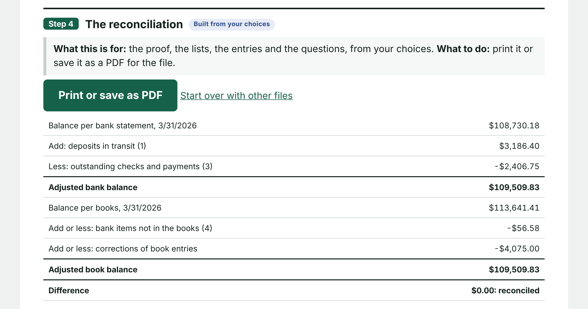
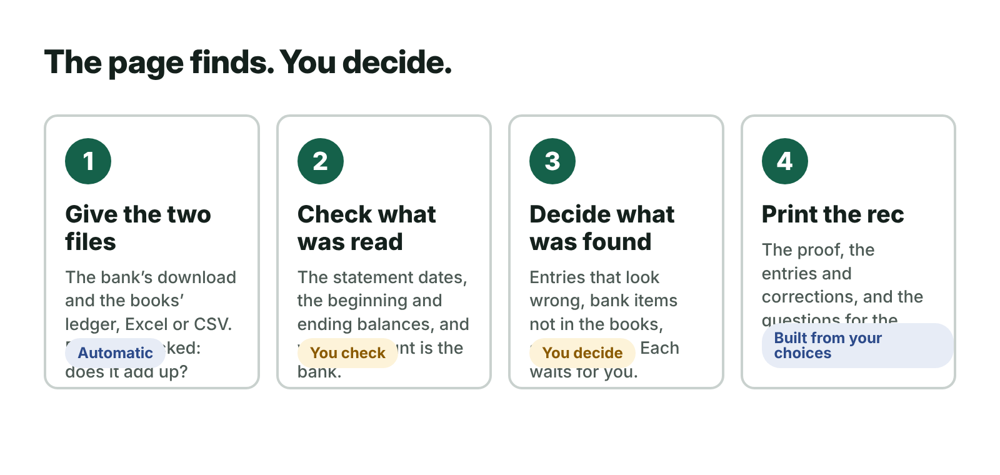
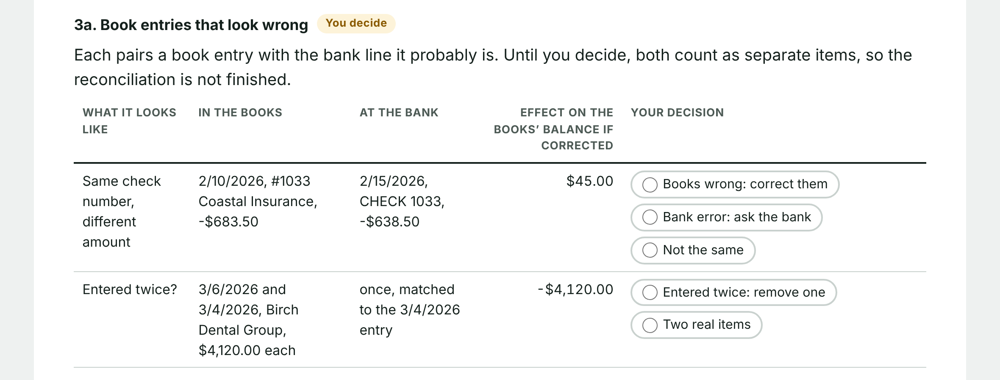

<!--
Published 2026-11-28 as a regular LinkedIn post (https://www.linkedin.com/feed/update/urn:li:ugcPost:7532513131529674752) with this article as a 9-page PDF.
One Painful Problem, Series 2, Agent 1 (Record-to-Report). Published as a regular LinkedIn post
(LINKEDIN-POST.txt) with this article as a PDF (build_pdf.js). LinkedIn's editor has no tables: lists are used instead.
SEO title (max 60): Why won't the bank rec tie? A free matching tool
SEO description (140-160): Match a client's bank download to the books, find the typo, the duplicate and the stale check, and print the proof. Free, rebuildable from one prompt.
-->

# Series 2 · Agent 1 | Why won't the bank rec tie?



The client sends three months of bank statements and a note: "QuickBooks says it's off. Can you look?"

The checking account at Mapleton Landscaping has 62 bank lines for the quarter and about a hundred entries in the books. The difference is not one round number you can search for. It is several things at once:
- check #1033 entered as $683.50, paid by the bank as $638.50;
- a $4,120.00 customer payment entered twice, two days apart;
- three card sales recorded one by one that arrive as one deposit of $766.55;
- three monthly service fees and a little interest the books never recorded;
- a $415.00 check from last August that was never cashed.

Mapleton is invented. It is the sample client for this tool. But anyone who does catch-up bookkeeping or a quarterly close has met it. By hand, ticking off three statements and then comparing two lists line by line to find what is left takes us about two to three hours (an estimate, not a measurement).

This is Series 2, Agent 1: a free tool that does the matching, so you can spend the time on the decisions.

## What it gives you

You drop in two files: the transactions downloaded from the bank's website, and the books' ledger for the same account from QuickBooks Online, QuickBooks Desktop or Xero. You get a reconciliation you can print or save as a PDF:
- **The proof.** Balance per bank, plus deposits in transit, less outstanding checks; balance per books, plus or less the bank items and the corrections. For Mapleton both come to $109,509.83.
- **What is outstanding, and how old.** Checks over six months are flagged stale-dated, over 90 days old, and deposits not at the bank after 10 days are flagged too.
- **What the bank has that the books do not,** with a suggested treatment: a bank charge, interest, a returned check that goes back on the customer's balance, or a question for the client.
- **The entries and corrections,** dated at the statement date.
- **The questions for the client.** For Mapleton: did the payee of check #998 ever receive it?

The files are read on your computer. Nothing is uploaded, stored or sent.

## How it works: the page finds, you decide



**1. Give the two files.** Automatic. The page checks that each one adds up: the bank's running balance day by day, and the ledger against its own totals. If a line is missing, it stops and says so rather than reconcile a broken file.

**2. Check what was read.** You check. The statement dates, the beginning and ending balances, and which account in the books is the bank account. If the bank's download has no balances, you type them from the statement.

**3. Decide what was found.** You decide. The page matches checks by number first, then the same amount within a window (up to 60 days back, 180 for checks), then card batches (several book entries that add up to one deposit). What is left is where the time usually goes:
- **Book entries that look wrong.** A check for a different amount than the bank paid, digits swapped, money in and out reversed, a voided check the bank paid anyway, a check paid twice, an entry made twice. **The page decides none of them.** Until you do, both sides count as separate items, and the reconciliation says it is not finished.
- **At the bank, not in the books.** Each with a suggested treatment you can change.
- **Outstanding.** With its age. A stale check waits for you: keep it outstanding, or reverse it to a liability.



It also does the part that is easy to forget: which checks were already outstanding when the bank's file starts. It works that out from the two starting balances. When more than one set of old checks would fit, it asks you to tick the right ones instead of choosing.

**4. Print the reconciliation.** Built from your choices. Anything still open is listed at the top in red.

## What the reviews found

Before release, a separate AI review played a skeptical CPA and ran 18 file pairs of its own. Its verdict on the first version: not ready. The worst problem was that the start of the bank file worked like a plug. Whatever old items added up to the difference were declared outstanding, so the rec tied by construction. In one of its files, an unrecorded $1,200 loan payment disappeared that way. It also found a customer's check number matched to the company's own check, and "fee" matched inside "coffee". All of these are fixed, and each is now a test file. The tool must pass 28 test files, 839 checks in all.

A second review played a first-time user working from the screen alone. It found that the page could say "It ties" while an unexplained difference sat in the opening balances. Now it says "ties" only when every entry that looks wrong is decided and the start is explained. A stale check still to decide is named next to it.

The last check was the prompt itself. A fresh AI session, given only the prompt, rebuilt the tool and ran it through the same tests: 22 of 27 on the first try, all 27 after one round of fixes taken from the prompt. It listed every place the prompt was unclear, and those are now spelled out. It also found a real bug: a statement balance typed wrong stopped the page with no way back except starting over. That is fixed, and it is test file 28.

## Build it yourself

You don't need to download anything from me to have this tool. It comes from one prompt, and you can rebuild it with an AI assistant in about 15 minutes. You need no coding and no Excel skills.

**What you need**
- A computer with a web browser and an internet connection. The page you build loads its spreadsheet reader from the internet each time it opens. (The ready-made tool in the repository works offline.)
- An AI chat assistant that can write a long piece of code in one reply, such as Claude at claude.ai. The reply is long (about 1,000 lines), so a free plan may stop partway; a paid plan is safer.
- About 15 minutes, most of it waiting for the reply.

**Steps**
1. **Copy the prompt.** The safest copy is the master on GitHub. The repository's name is a single hyphen (github.com/accountingnonerd/-), and that is right. Open [PROMPT.txt](https://github.com/accountingnonerd/-/blob/main/record-to-report/02-why-wont-the-bank-rec-tie/PROMPT.txt) and press the "Copy raw file" button (two small squares next to "Raw", top right of the file). The prompt is long, about 34,000 characters; some assistants show a paste that long as an attached file. That is normal. It is also printed in full below.
2. **Paste it into a new chat** in your AI assistant and send it.
3. **Wait for one long block of code.** If the assistant offers it as a file to download, or shows it in a side panel with a download or copy button, use that. If the reply stops partway, write: "Please send the complete file again in one code block."
4. **Save it as a web page.** If there was no download, copy the whole code block into a plain-text editor and save it as why-wont-the-bank-rec-tie.html. On Windows, use Notepad: in the Save dialog, set "Save as type" to "All files", or it saves as .html.txt. On a Mac, use TextEdit: first choose Format, then Make Plain Text, and when it asks, choose "Use .html".
5. **Open it.** Double-click the file. You should see "Why won't the bank rec tie?" and two boxes to drop files into.
6. **Try it on the sample client** before any real file. Download the [Mapleton bank download](https://github.com/accountingnonerd/-/blob/main/record-to-report/02-why-wont-the-bank-rec-tie/sample/mapleton-checking-bank-download-q1-2026.csv) and the [Mapleton ledger](https://github.com/accountingnonerd/-/blob/main/record-to-report/02-why-wont-the-bank-rec-tie/sample/mapleton-general-ledger.xlsx). On each page, press "Download raw file". Drop the bank file in the box "The bank's download" and the ledger in "The books' ledger", and follow the steps on the screen.

**What you should see.** The top line reads "Mapleton Landscaping LLC, Checking, 3/31/2026. Not finished: 2 items to decide before it can be called reconciled." In step 2 the balances are $81,868.88 and $108,730.18; press "This is right". In step 3a, choose "Books wrong: correct them" for check #1033 and "Entered twice: remove one" for the Birch Dental deposit. The top line already reads "It ties ... Still to decide: 1 stale check (step 3c)", and the counts drop (5 bank items to 4, 6 outstanding to 4), because the paired lines are now one item. In 3b, the four suggested treatments are right; change nothing. In 3c, keep the stale check #998 outstanding. The top line then reads "It ties: adjusted bank and adjusted books are both $109,509.83." The full walkthrough is in the [sample's README](https://github.com/accountingnonerd/-/blob/main/record-to-report/02-why-wont-the-bank-rec-tie/sample/README.md).

**If it does not work**
- *A blank page, or half a page:* the code was cut off. Ask the assistant for the complete file again.
- *Nothing happens when you drop a file:* the page could not load its spreadsheet reader. Check your internet connection; a company firewall can block it. Or use the ready-made tool.
- *Different numbers:* tell the assistant what you expected, quoting the line above, and ask it to fix the file so it follows the prompt exactly.
- *Still stuck:* the ready-made, tested tool is in the repository. It is one file that works offline.

**The repository.** [The One Painful Problem repository on GitHub](https://github.com/accountingnonerd/-/tree/main/record-to-report/02-why-wont-the-bank-rec-tie) holds everything for this tool:
- a README with these same steps;
- the master prompt;
- the sample client and what you should see;
- the ready-made tool;
- the 28 test files and their results.

**The prompt.** Copy it from the master copy on GitHub if you can. LinkedIn can change quotes and line breaks.

```text
{{PROMPT}}
```

## What it doesn't do

- **It reconciles bank accounts only.** Credit cards and loans are refused with a message, for now.
- **It makes one reconciliation for the whole span.** For a quarter's catch-up, that is one rec at the quarter end, not one per month.
- **It does not read last month's outstanding list.** When the starting balances leave more than one answer, it asks you to tick the items from that list.
- **It does not post anything.** It proposes entries and corrections; you decide.
- **It has not met real client exports yet.** It was tested on files built from the banks' and the products' published layouts. If your download doesn't read, tell me and I will add the layout.

---

## What's next

This is the first agent of Series 2: four more to come, one for each of the other processes, each one free. Next: the 13-week cash flow.

**Follow me** so the next one reaches you, with its prompt, its sample and its tests.

**Rebuilt it?** Tell me in the comments what your AI assistant got right the first time, and what you had to ask it twice.
